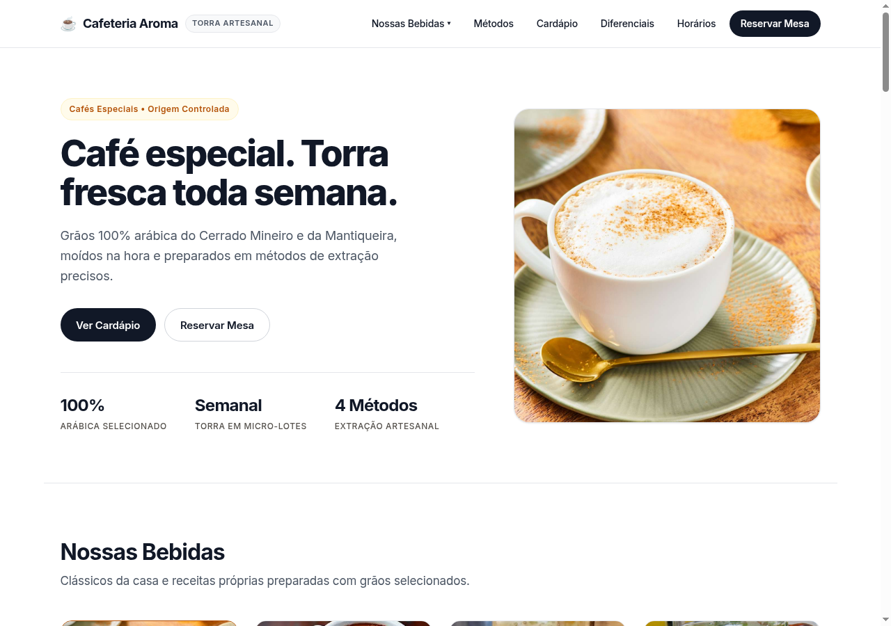
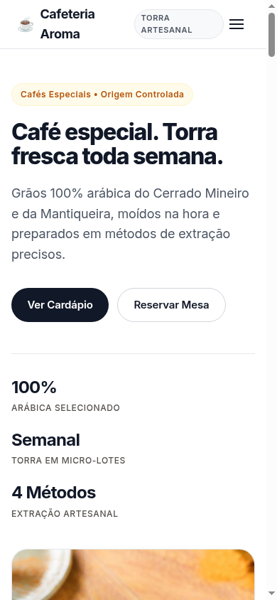

# Cafeteria Aroma

Página web da Cafeteria Aroma, feita para clientes que procuram cafés especiais e chás artesanais. O site apresenta o cardápio da casa, um vídeo sobre o preparo do café, gráficos de intensidade sensorial, uma consulta de preços por orçamento e um formulário para reservar mesa.

## Tecnologias utilizadas

- HTML5 semântico (`header`, `nav`, `main`, `section`, `article`, `footer`, formulários com validação nativa e mídia `<video>` com `<track>` WebVTT)
- CSS3 (`:root` custom properties, Flexbox, CSS Grid, pseudo-classes estruturais, animações com `transform` e Media Queries)
- JavaScript puro (ES6+: lógica estruturada, funções puras com escopo local, `map`/`filter`/`reduce`, criação segura de DOM com `createElement`/`textContent`/`replaceChildren` e delegação de eventos)
- SVG inline acessível e HTML5 Canvas 2D animado com `requestAnimationFrame` e `clearRect`

## Capturas de tela

### Desktop (1280x900)



### Celular (390x844)



## Estrutura de pastas

```text
projeto-integrador-frontend-Gabriel/
├── assets/
│   ├── images/
│   │   ├── cafe-expresso.webp
│   │   ├── cafe-gelado.webp
│   │   ├── cappuccino.jpg
│   │   ├── cha-artesanal.svg
│   │   ├── cha-artesanal.webp
│   │   ├── print-celular.png
│   │   └── print-desktop.png
│   └── media/
│       ├── extracao-cafe.mp4
│       ├── extracao-cafe.webm
│       ├── extracao-poster.jpg
│       └── legendas-cafe.vtt
├── css/
│   ├── reset.css
│   └── style.css
├── docs/
│   └── modelagem/
├── js/
│   └── script.js
├── index.html
└── README.md
```

## Como executar

1. Clone ou baixe o repositório para a sua máquina.
2. Abra o arquivo `index.html` diretamente no navegador ou inicie com a extensão Live Server no VS Code.
3. Na página, use o campo de busca (ou a tecla `/`), o filtro por categoria e o botão **Apenas Favoritos** para filtrar o cardápio.
4. Adicione novas bebidas no formulário **Cadastrar Nova Receita** e teste os botões de favoritar e remover criados dinamicamente.
5. Clique em **Abrir Consulta Interativa** para informar um orçamento limite via `prompt()`, navegar pelo menu em `do...while` e conferir a tabela completa no Console (`F12`).

## Mapa dos requisitos

| Requisito (Seção 2) | Arquivo | Localização / Implementação |
|---|---|---|
| Estrutura semântica (`header`, `nav`, `main`, `section`, `article`, `footer`) | `index.html` | Linhas 20, 30, 60, 62 a 371, 105 a 148, 450 |
| Formulário acessível com `label`, `fieldset`, `legend`, `required`, `pattern`/`min`/`max` | `index.html` | Seção `#secao-reserva` (linhas 382 a 445) |
| Multimídia `<video>` com 2 `<source>`, `poster`, `preload="none"` e `<track>` `.vtt` | `index.html` | Seção `#secao-multimidia` (linhas 153 a 170) |
| SVG inline acessível (`role="img"`, `<title>`, `<desc>`) e Canvas 2D animado | `index.html` / `js/script.js` | `index.html` (linhas 185 a 203); `iniciarGraficoCanvas` (`js/script.js`, linha 759) |
| Reset CSS (`box-sizing: border-box` e remoção de margens do `body`) | `css/reset.css` | Linhas 1 a 28 |
| Variáveis no `:root`, unidades `rem`, ordem LoVe/HAte e combinadores comentados | `css/style.css` | `:root` (linha 4), `a:link..:active` (linhas 73 a 85), combinadores (linhas 109, 466) |
| Navbar em Flexbox, `position: sticky`, dropdown e menu mobile | `css/style.css` | Linhas 128 a 306 e `@media (max-width: 680px)` (linhas 1287 a 1343) |
| Seções em Grid com pseudo-classes estruturais e hover com `transform` | `css/style.css` | `.trilho-destaques > .cafe-item:first-child` (linha 470), `.lista-cardapio > .card-item-catalogo:first-child` (linha 847), `.lista-diferenciais > li:nth-child(odd)` (linha 1059) |
| Responsividade celular e desktop | `css/style.css` | Media queries `@media (max-width: 900px)` (linha 1271) e `@media (max-width: 680px)` (linha 1287) |
| Dados (6 itens com 6 propriedades) e planejamento no topo | `js/script.js` | Comentário (linhas 1 a 44) e `const itensCardapio` (linhas 47 a 54) |
| Lógica (Aula 09): dados -> classificar -> resumir (`if/else if/else`, `switch`, `for...of`, `while`, `do...while`) | `js/script.js` | `classificarFaixaPreco` (linha 89), `obterEtiquetaCategoria` (linha 101), `executarAnaliseCardapio` (linha 159), `iniciarMenuInterativo` (linha 289) |
| Funções e escopo (Aula 10): 2+ funções, `const`/`let`, `Number()`, `return`, escopo local | `js/script.js` | `calcularPrecoFinal` (linha 66), `criarCalculadoraDesconto` (linha 81), `calcularResumo` (linha 143) |
| Arrays e DOM (Aula 11): `map`, `filter`, `reduce`, `createElement`/`textContent`, classes CSS | `js/script.js` | `criarElementoItem` (linha 361), `desenhar` (linha 443), `renderizarResumoAnalisador` (linha 249) |
| Eventos (Aula 12): `aria-expanded`, `aria-pressed`, teclado, delegação, busca/filtro e `aria-live="polite"` | `js/script.js` | `tratarCliqueLista` (linha 496), `tratarBusca` (linha 477), `tratarFiltroCategoria` (linha 482), `tratarAlternarFavoritos` (linha 487), `alternarMenuMobile` (linha 613), `tratarTecladoMenu` (linha 627) |
| Script único ligado ao final do `<body>` com `defer` | `index.html` | `<script src="js/script.js" defer></script>` (linha 465) |

## Autor

- Nome: Gabriel Amâncio Campos Crispim
- RGM: 47012412
- Curso: Análise e Desenvolvimento de Sistemas (UNIPÊ)

---

## Histórico de avaliações por pares

- Avaliação em pares (02/09): Nota 10,0 em Git/GitHub, HTML mínimo válido, semântica e formulários.
- Avaliação em pares (21/10, Arthur Evangelista): Nota 10,0 em estrutura semântica, navegação e organização do repositório.
